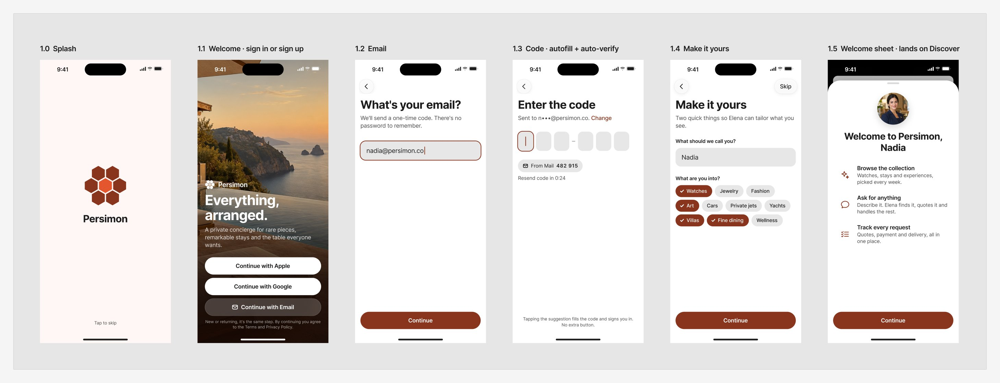
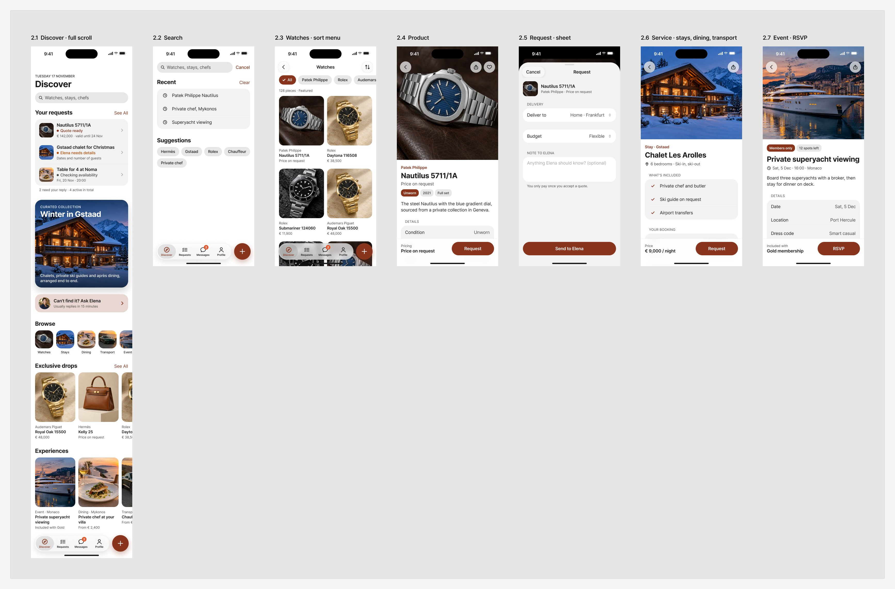
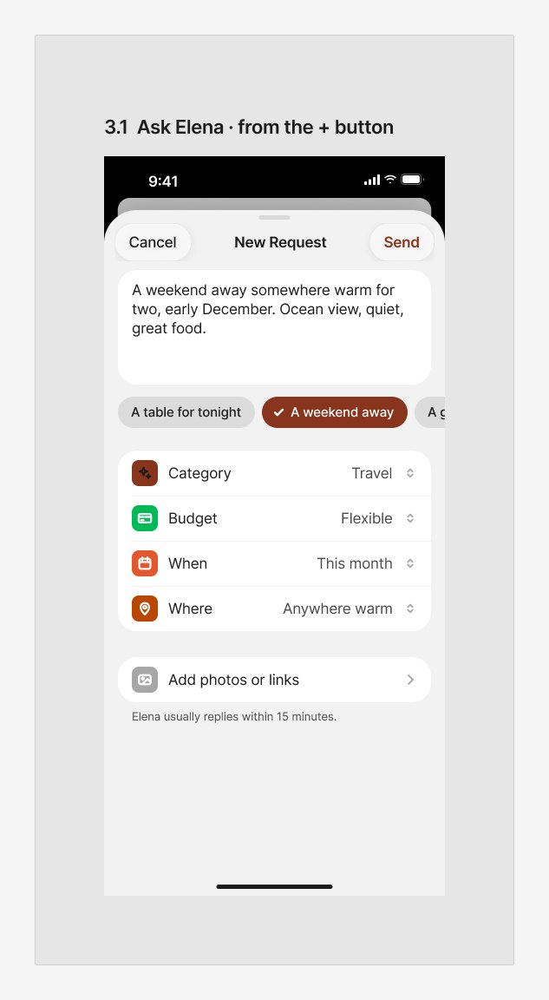
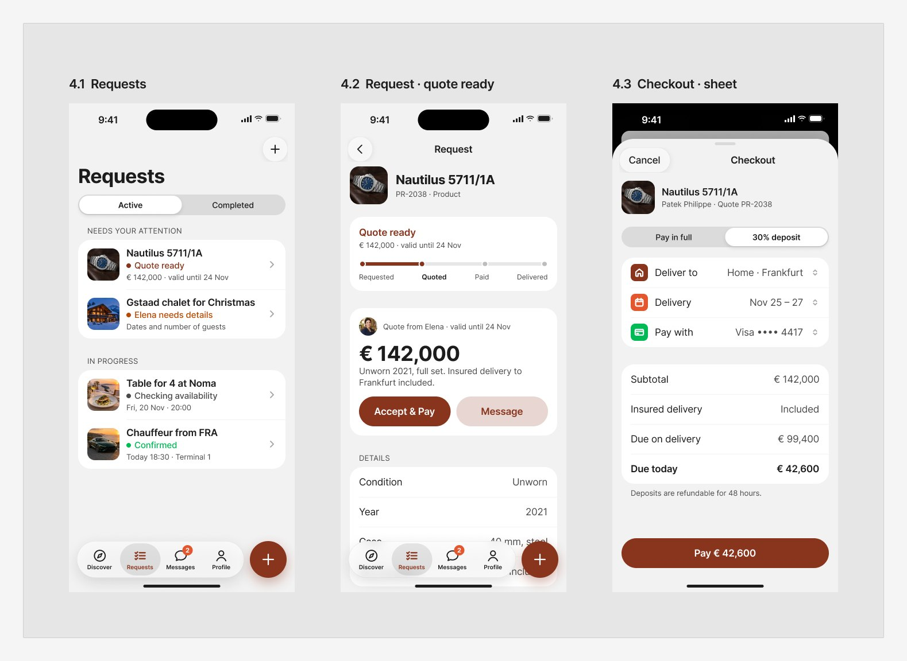
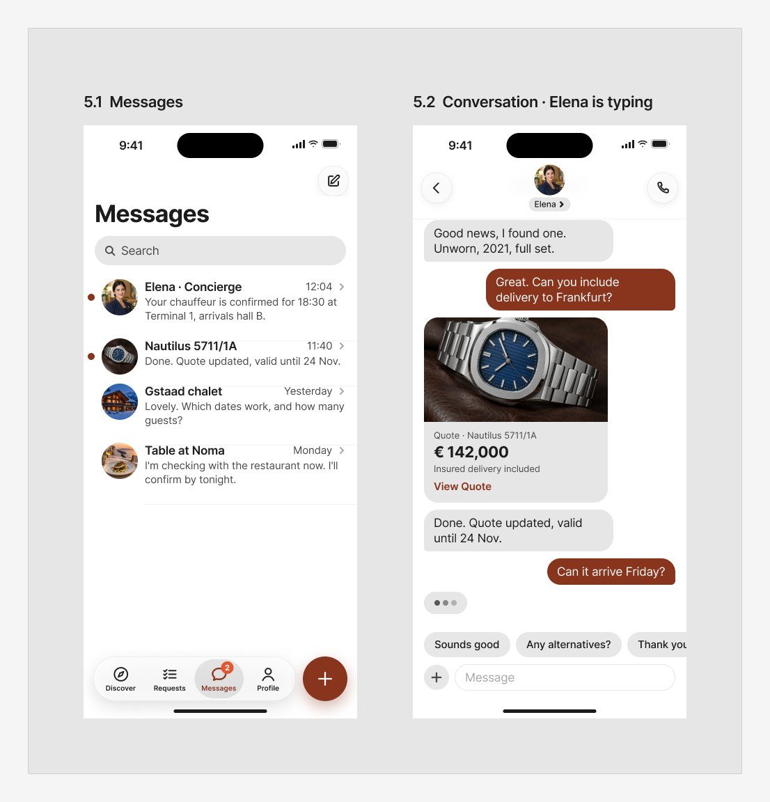
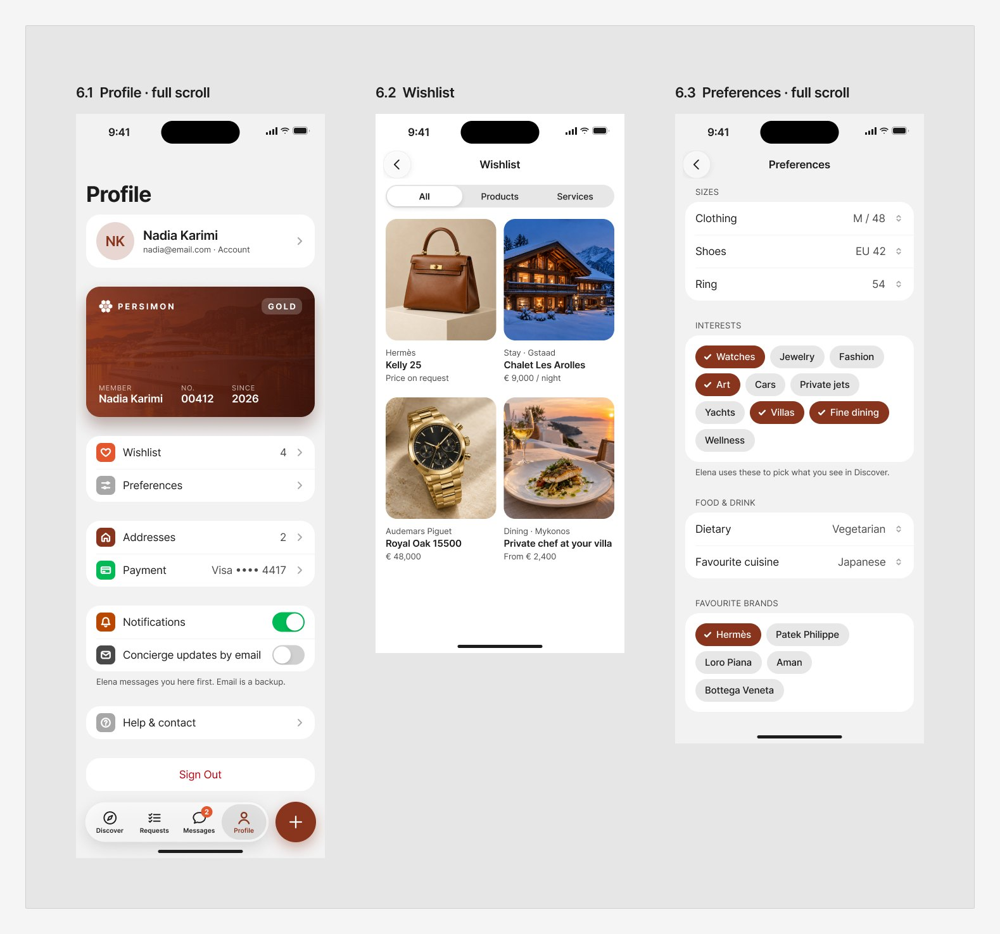

# Persimon

Clickable prototype for Persimon, a luxury concierge app: browse curated pieces, stays and experiences, or ask for anything, and a personal concierge handles it from quote to delivery.

## Files

- `index.html` is the current prototype (v2), designed like a native iOS app: large titles, translucent bars, inset grouped lists, sheets, a floating tab bar, swipe-back and light/dark mode. It opens with the animated splash (`anim/persimon-onboarding.json`, played with lottie-web).
- `lofi.html` is the earlier grayscale lo-fi version of the flows.
- `img/` holds the generated photography.

- `design/` holds exports of the iOS design from Figma (page "Hi-Fi · iOS"): one image per flow plus the component kit.

Both pages are static files with no build step. Open `index.html` in a browser, or serve the folder.

## Design

22 screens in six flows, built in Figma from an iOS-style kit that uses the Persimon colour variables. The prototype follows the same screens.

**Welcome** — one passwordless step for new and returning members: Apple, Google or email, then a code that fills itself in from Mail.

**Discover** — active requests sit at the top of Home, followed by curated collections, categories and drops. Requesting an item opens a sheet.

**Ask, Requests, Messages, Profile** — the + button asks Elena for anything; requests track quote, payment and delivery; chat is iMessage-style; Profile lives in the tab bar only.

The component kit (status bar, nav bar, tab bar, buttons, rows, segmented controls, chips, cards, bubbles, sheet header) is in [`design/00-ios-kit.jpg`](design/00-ios-kit.jpg).

## Deploy on Vercel

Import this repo at vercel.com/new. Leave the framework preset as "Other" with no build command; Vercel serves `index.html` from the root, and the lo-fi stays reachable at `/lofi.html`.

## Using the prototype

- On desktop, the left panel lists every screen, sheet and state; pick one to jump straight there. Arrow keys step through them.
- On the phone, swipe from the left edge to go back and drag a sheet down to close it.
- Toggle dark mode and hotspots from the left panel.
- On a phone browser, the prototype runs full-screen; the "Screens" button at the top opens the list.

## Sign-in buttons

The "Continue with Apple" and "Continue with Google" buttons show text only. To show the official marks, add Apple's and Google's published button artwork as `img/apple.svg` and `img/google.svg`; the buttons pick them up automatically.

Images are AI-generated placeholders for presentation only. Product and brand names are illustrative.
